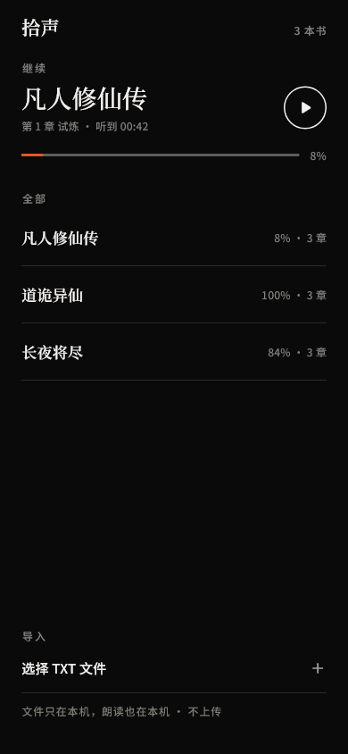
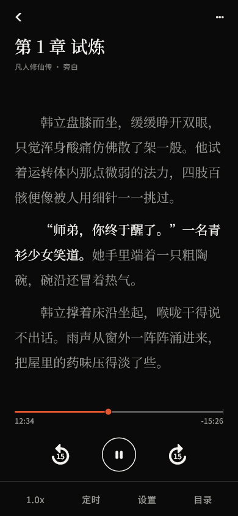
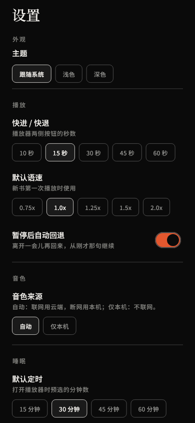
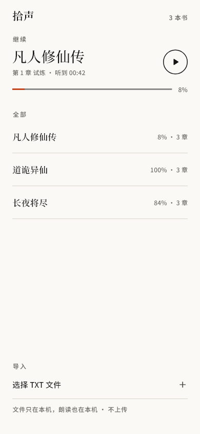

<div align="center">

# 拾声

**把一本 TXT 丢进去，它自己切章、分角色，在手机里合成，断网也能听。**

Android · Flutter · 端侧 TTS · 无需账号

</div>

| 书架 | 目录 | 播放 |
|---|---|---|
|  |  |  |

| 设置 | 浅色 |
|---|---|
|  |  |

## 它解决什么

夜里躺着听书。不想联网、不想登录、不想开会员，也不想等一整个音频文件下载完。

所以整条链路都在手机上：

```
TXT → 切章 → 分句分人 → 逐块合成（Kokoro int8）→ 边合成边播
```

- **导入自己的 TXT**：UTF-8 / GBK 都认。不带任何书。
- **自动切章**：按「第 N 章 / 第 N 回」这类行切；没有章节标记的长文按长度兜底切。
- **分角色配音**：引号里的对白算对白，引号外算旁白；再按上下文（「某某道」「某某曰」）推断说话人。同一个人全篇恒定一个音色，男女老少分开——不是一个人从头念到尾。
- **端侧合成**：Kokoro-82M-v1.1-zh int8，102 个中文音色，24kHz，跑在 `sherpa_onnx` 上。装完第一次启动解压模型（约 170MB，几十秒），之后不再需要电脑。
- **边合成边播**：预渲前 3 章；播放到哪合成到哪，手机存储和算力不够时也不会卡死。
- **播放页逐句高亮**：显示当前段前后各 2 段，当前句亮、其余暗，跟着声音滚动。
- **音色来源开关**：`仅本机`（默认，全部在本机合成，不联网）/ `自动`（联网走云端音色，断网自动退回本机）。见下方[说明](#云端音色默认关闭)。
- 其它：快进快退、变速、睡眠定时、暂停后自动回退、断点续听、锁屏与通知栏控制、深/浅色主题。

## 构建

需要 Flutter 3.47+（开发时用 3.47.9 / Dart 3.13.7）、Android SDK 36、JDK 17。

```bash
git clone https://github.com/windfall33/shisheng.git
cd shisheng

# 1. 下载语音模型（约 177MB，不入库）
bash tool/fetch_model.sh
#   Windows: powershell -ExecutionPolicy Bypass -File tool\fetch_model.ps1
#   国内网络: HF_ENDPOINT=https://hf-mirror.com bash tool/fetch_model.sh

# 2. 构建
cd app
flutter pub get
flutter build apk --release
```

产物在 `app/build/app/outputs/flutter-apk/app-release.apk`（约 260MB，模型打进包里）。

`flutter run` 在 Windows 桌面上跑的是**预览模式**：只灌演示书数据看界面，合成和播放都是空的——端侧引擎只接了 Android。

## 代码在哪

| 路径 | 内容 |
|---|---|
| `app/lib/textfront.dart` | TXT → 章节 → 句子 → 说话人 |
| `app/lib/voices.dart` | 说话人 → 音色（同名恒定、性别/年龄/气质匹配） |
| `app/lib/render.dart` | 渲染队列 `NOW > USER > AUTO`，逐块合成，写 `index.json` 时间轴 |
| `app/lib/engine.dart` | sherpa_onnx / Kokoro 的 isolate 池 |
| `app/lib/tserver.dart` | `127.0.0.1` 虚拟 WAV 流，支持 Range 跳转（边合成边播的关键） |
| `app/lib/player.dart` | 播放页 |
| `app/lib/screens.dart` | 书架 / 目录 / 设置 |
| `app/lib/design.dart` | 设计 token：颜色、字号、间距、动效 |
| `app/DESIGN.md` | 设计说明：每屏主角、五态、对比度、为什么这么排 |

## 云端音色（默认关闭）

设置里可以把「音色来源」切成 `自动`，联网时用微软 Edge 浏览器「大声朗读」的接口合成的音色，断网或失败时自动退回本机。

要说清楚三件事：

1. 那是**私有接口**，不是公开 API，随时可能改协议或封禁，届时这一路会失效（回退本机，不影响听书）。
2. 选了它，**章节正文会逐句发到微软那边**。默认是 `仅本机`，不会发生这件事。
3. 相关代码在 `app/lib/cloud/edge_tts2/`，许可与原项目一致（MIT + 一处 LGPL-3.0 移植段），详见 [NOTICE.md](NOTICE.md)。

## 已知问题

- **存储清理没做**：合成音频只增不减，一本书听下来可能占几百 MB。目前只能靠系统设置里清应用数据。这是发布前必须补的。
- **release 用的是 debug 签名**，不能上架，只能自己装。
- **没有真机性能数据**：只在 Redmi K90（骁龙 8 系）上短时试过，不同机型上首次合成一章要多久、发热多少，没测过。
- 只解析 TXT，epub / mobi 不支持。
- 音色是 TTS，不是真人配音；多音字、生僻字会读错，词典在 `assets/tts/lexicon-zh.txt`。

## 许可

GPL-3.0，见 [LICENSE](LICENSE)。第三方组件（模型、字体、播放器、Edge 模块）的许可见 [NOTICE.md](NOTICE.md)。

模型 [Kokoro-82M-v1.1-zh](https://huggingface.co/csukuangfj/kokoro-int8-multi-lang-v1_1) 为 Apache-2.0，字体子集来自思源宋体 / 思源黑体（SIL OFL 1.1）。

仓库里不含任何在版权期内的书籍正文：演示数据和测试夹具用的都是公有领域的《聊斋志异》。
