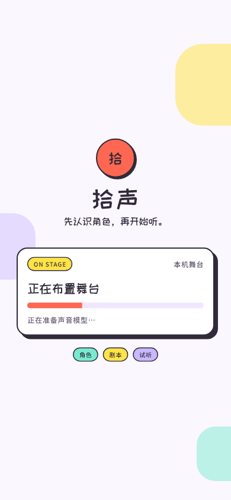
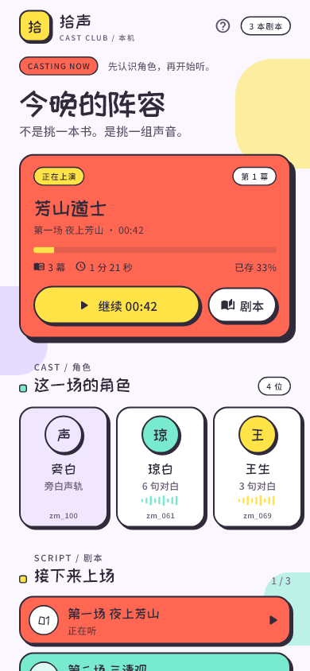
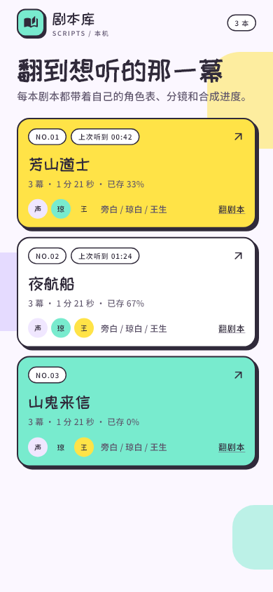
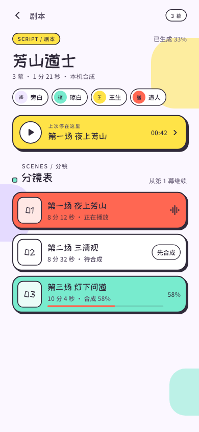
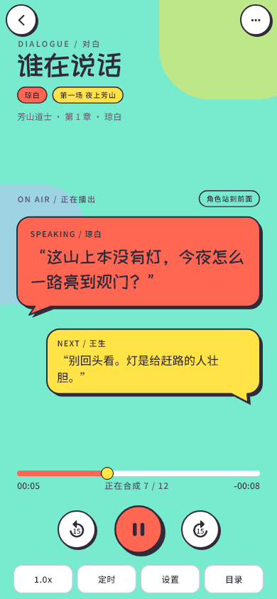
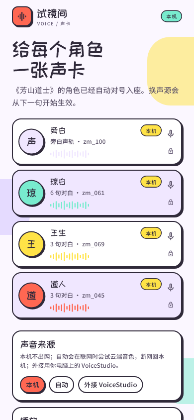

<div align="center">

# 拾声

[](https://github.com/windfall33/shisheng/actions/workflows/ci.yml)

**先认识角色，再开始听。**

把一本 TXT 丢进去，拾声拆出角色、场景和对白，在手机里合成，断网也能听。

Android · Flutter · 端侧 TTS · CAST CLUB · 无需账号

[下载 APK](https://github.com/windfall33/shisheng/releases/latest) · 当前版本 v1.1.0

</div>

| 启动 | 阵容 | 剧本库 |
|---|---|---|
|  |  |  |

| 分镜 | 对白 | 试镜 |
|---|---|---|
|  |  |  |

## 它解决什么

夜里躺着听书。不想联网、不想登录、不想开会员，也不想等一整个音频文件下载完。

但听书之前，先得知道这一场有谁。拾声把「角色」放到书架前面：先看今晚的阵容，
再翻剧本和分镜，最后进入对白页听谁在说话。

所以整条链路都在手机上：

```
TXT → 切章 → 分句分人 → 逐块合成（Kokoro int8）→ 边合成边播
```

- **导入自己的 TXT**：UTF-8 / GBK 都认。不带任何书。
- **自动切章**：按「第 N 章 / 第 N 回」这类行切；没有章节标记的长文按长度兜底切。
- **分角色配音**：引号里的对白算对白，引号外算旁白；再按上下文（「某某道」「某某曰」）推断说话人。同一个人全篇恒定一个音色，男女老少分开——不是一个人从头念到尾。
- **端侧合成**：Kokoro-82M-v1.1-zh int8，102 个中文音色，24kHz，跑在 `sherpa_onnx` 上。装完第一次启动解压模型（约 170MB，几十秒），之后不再需要电脑。
- **边合成边播**：预渲前 3 章；播放到哪合成到哪，手机存储和算力不够时也不会卡死。
- **阵容首页**：当前书、当前幕、这一场有谁，一眼看完；角色出场数从正文的说话人统计，不按封面编造。
- **剧本库 + 分镜**：每本 TXT 都有角色表、场次和合成进度，点一场直接继续听。
- **对白页**：当前说话的人站出来，旁白退到浅紫卡片，下一句在黄色气泡里等；逐句跟随原来的播放状态机。
- **试镜间**：每个角色一张声卡，显示对白与声线编号；本机 / 自动 / 外接 VoiceStudio 在这一页收口。逐角色即时试听尚未实现。
- **音色来源开关**：`仅本机`（默认，全部在本机合成，不联网）/ `自动`（联网走云端音色，断网自动退回本机）。见下方[说明](#云端音色默认关闭)。
- **可选外接 VoiceStudio**：设置 → 音色 → 外接 VoiceStudio，填电脑端地址和 API Key，即可用 VoiceStudio 的克隆/设计音色；断线自动回退本机。见下方[说明](#外接-voicestudio可选)。
- 其它：快进快退、变速、睡眠定时、暂停后自动回退、断点续听、锁屏与通知栏控制、深/浅色主题。

## 构建

需要 Flutter 3.47+（开发时用 3.47.9 / Dart 3.13.7）、Android SDK 36、JDK 17。

```bash
git clone https://github.com/windfall33/shisheng.git
cd shisheng

# 1. 下载语音模型（约 177MB，不入库）
bash tool/fetch_model.sh
#   Windows: powershell -ExecutionPolicy Bypass -File tool\fetch_model.ps1
#   国内网络: HF_ENDPOINT=https://hf-mirror.com bash tool/fetch_model.sh

# 2. 配一个自己的签名（仓库里不带密钥）
bash tool/make_keystore.sh        # 生成 keys/release.jks 并写好 app/android/key.properties

# 3. 构建
cd app
flutter pub get
flutter build apk --release
```

`--release` 必须能读到 `app/android/key.properties`，否则构建会停下并告诉你怎么生成；
只想装在自己手机上试，用 `flutter build apk --debug` 也可以（包更大、更慢）。

产物在 `app/build/app/outputs/flutter-apk/app-release.apk`（约 260MB，模型打进包里）。

`flutter run` 在 Windows 桌面上跑的是**预览模式**：只灌演示书数据看界面，合成和播放都是空的——端侧引擎只接了 Android。

## 代码在哪

| 路径 | 内容 |
|---|---|
| `app/lib/textfront.dart` | TXT → 章节 → 句子 → 说话人 |
| `app/lib/voices.dart` | 说话人 → 音色（同名恒定、性别/年龄/气质匹配） |
| `app/lib/render.dart` | 渲染队列 `NOW > USER > AUTO`，逐块合成，写 `index.json` 时间轴 |
| `app/lib/cleanup.dart` | 存储清理：容量上限 + LRU（章节层先清，段缓存层兜底） |
| `app/lib/perflog.dart` | 性能日志环形缓冲，导出 JSONL（设置页入口） |
| `app/lib/engine.dart` | sherpa_onnx / Kokoro 的 isolate 池 |
| `app/lib/tserver.dart` | `127.0.0.1` 虚拟 WAV 流，支持 Range 跳转（边合成边播的关键） |
| `app/lib/voicestudio.dart` | 可选外接 VoiceStudio 的 OpenAI 兼容 HTTP 客户端（只发文本，不打包其代码） |
| `app/lib/club_screens.dart` | 阵容 / 剧本库 / 分镜 / 试镜 / 设置 |
| `app/lib/club_ui.dart` | 角色卡、对白气泡、粗描边卡片等 CAST CLUB 组件 |
| `app/lib/player.dart` | 对白播放页 |
| `app/lib/screens.dart` | 共享设置控件与旧版辅助页面 |
| `app/lib/design.dart` | 设计 token：颜色、字体、间距、动效 |
| `app/DESIGN.md` | CAST CLUB 设计说明：每屏主角、数据真实性、响应式 |

## 云端音色（默认关闭）

设置里可以把「音色来源」切成 `自动`，联网时用微软 Edge 浏览器「大声朗读」的接口合成的音色，断网或失败时自动退回本机。

要说清楚三件事：

1. 那是**私有接口**，不是公开 API，随时可能改协议或封禁，届时这一路会失效（回退本机，不影响听书）。
2. 选了它，**章节正文会逐句发到微软那边**。默认是 `仅本机`，不会发生这件事。
3. 相关代码在 `app/lib/cloud/edge_tts2/`，许可与原项目一致（MIT + 一处 LGPL-3.0 移植段），详见 [NOTICE.md](NOTICE.md)。

## 外接 VoiceStudio（可选）

[VoiceStudio](https://github.com/debpalash/VoiceStudio) 是一个独立的本地语音工作台，
支持声音克隆、音色设计、有声书等。拾声不打包它的代码，只在设置里增加一路
「外接 VoiceStudio」：

1. 在电脑或另一台手机上运行 VoiceStudio，打开它的 Local / Phone Speech API；
2. 拾声 → 设置 → 音色 → 外接 VoiceStudio，填地址（如 `http://192.168.1.20:3900`）
   和 API Key（如果开了）；点「测试连接」；
3. 「选旁白音色」「选对白音色」从 VoiceStudio 的音色列表里挑，或者直接填 profile id。

拾声调用的是 VoiceStudio 公开的 OpenAI 兼容接口
`POST /v1/audio/speech`（`response_format: pcm`），返回 24kHz/16-bit/mono PCM，
正好接进现有渲染管线。请求失败、超时或断网时自动回退本机 Kokoro，
不会让播放卡死。这个开关默认关闭；不打开时所有合成都只在本机。

注意：VoiceStudio 以 AGPL-3.0 发布，拾声只通过 HTTP 调用它、不复制其代码。
两边需要能互相访问（同一 Wi-Fi / Tailscale / 可信局域网）。

## 已知问题

- **真机性能数据还没采**：v1.0.1 起内置性能日志（设置 → 存储 → 导出性能日志），
  各机型跑一轮导入 + 播放再导出，就能拿到首块等待和每章 RTF。目前只在
  Redmi K90（骁龙 8 系）上短时试过。
- 只解析 TXT，epub / mobi 不支持。
- 音色是 TTS，不是真人配音；多音字、生僻字会读错，词典在 `assets/tts/lexicon-zh.txt`。
- 外接 VoiceStudio 目前按「旁白 / 对白」两路选音色，还没有逐角色映射；
  需要逐角色克隆时，先在 VoiceStudio 里建 profile，再把 id 填进对应字段。
- VoiceStudio 的局域网地址通常是 `http://`；App 为这一路放开了明文，只建议在
  可信局域网使用，不要把 VoiceStudio 暴露到公网。

## 许可

GPL-3.0，见 [LICENSE](LICENSE)。第三方组件（模型、字体、播放器、Edge 模块）的许可见 [NOTICE.md](NOTICE.md)。

模型 [Kokoro-82M-v1.1-zh](https://huggingface.co/csukuangfj/kokoro-int8-multi-lang-v1_1) 为 Apache-2.0。标题字体为 ZCOOL KuaiLe，正文字体为思源黑体子集，均按 SIL OFL 1.1 使用。

仓库里不含任何在版权期内的书籍正文：演示数据和测试夹具用的都是公有领域的《聊斋志异》。
